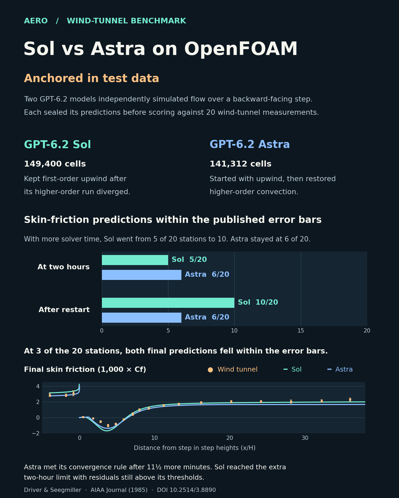

# Week 1 of AI Engineering Analysis Against Test Data
## Sol vs Astra on OpenFOAM

[Watch the 15-second simulation video (MP4)](https://raw.githubusercontent.com/alexthegreat714/alex-blythe-site/main/public/demos/aero/week-1-sol-vs-astra/linkedin-sol-vs-astra-flow.mp4) · [Full benchmark write-up](linkedin-week-1-post.txt) · [Station measurements and prediction errors](paired_deltas.csv) · [Results before and after restart](horizon_comparison.json)

The video shows tracers moving through each model’s final steady OpenFOAM velocity field. Gold points and error bars on the lower plot are wind-tunnel measurements. At the two-hour cutoff, Sol predicted wall friction within experimental error at 5 of 20 stations and Astra at 6. After continuation, Sol finished at 10 and Astra at 6, with 3 shared stations. Only Astra met its convergence criteria.

[Experimental paper](https://doi.org/10.2514/3.8890) · [Experimental data](https://tmbwg.github.io/turbmodels/backstep_val.html)
